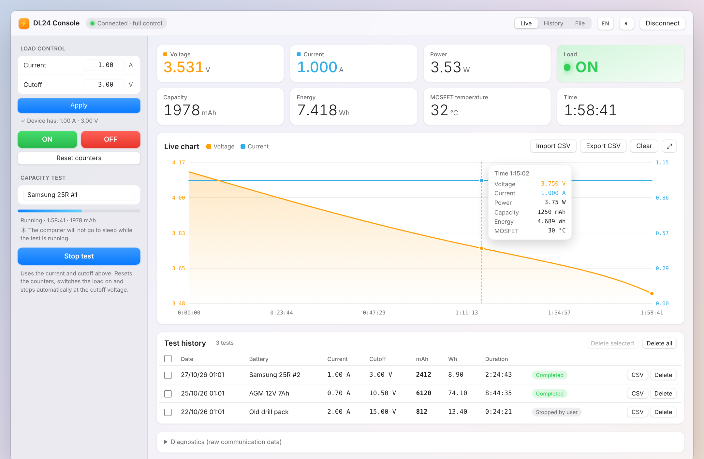
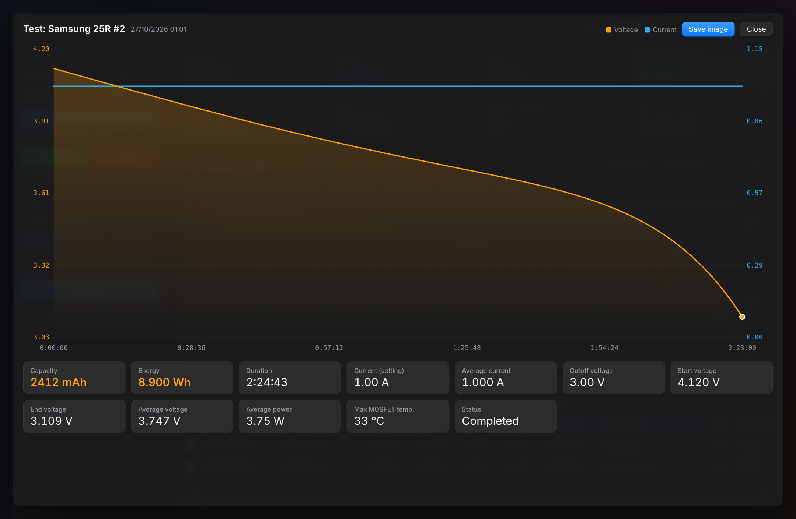

# DL24 Console

A modern, single-file desktop console for the **ATORCH DL24** electronic load / battery capacity tester.
It replaces the unreliable stock PC software with a clean, offline web app that runs in your browser and talks to the device directly over Bluetooth or USB.

No installation, no drivers beyond the standard serial driver, no server, no account. Just open one HTML file.

---

## Features

**Live monitoring**
- Voltage, current, power, capacity (mAh), energy (Wh), MOSFET temperature and elapsed time, updated every second
- Large ON / OFF load indicator (green / red)
- Live chart of voltage and current with a filled voltage curve
- Hover over the chart to see the exact values at any point in time

**Load control** (PX100 protocol)
- Set the load current and cutoff voltage from the computer (press **Apply** or Enter)
- The values the device actually stored are read back and shown for confirmation
- Switch the load ON / OFF and reset the counters

**Capacity test**
- One click: resets counters, applies current and cutoff, switches the load on, and stops automatically when the device reaches the cutoff voltage
- Progress bar based on the voltage drop towards the cutoff
- Every finished test is saved to a local history

**Built for long tests (10–30+ hours)**
- **Automatic reconnection**: if the Bluetooth or USB link drops, the console keeps retrying and continues the *same* test once the link is back. The DL24 keeps measuring on its own, so no capacity is lost. The gap is shown as a break in the chart.
- **Silent-link detection**: if the port stays open but no data arrives for 15 seconds, the port is reopened automatically
- **Keeps the computer awake** while a test runs (Screen Wake Lock), with a warning if it can't
- **Autosave and resume**: the running test is saved every minute. If the browser is closed or crashes, you are offered to resume it, save it as is, or discard it.

**History and results**
- Test history with date, battery name, current, cutoff, mAh, Wh, duration and status
- Click a test to view its chart; tick several to **Delete selected**, or **Delete all**
- Expanded view with a large chart and a results panel: capacity, energy, duration, average current, start / end / average voltage, average power, max MOSFET temperature
- **Save image**: exports a PNG with the title, chart and results, ready to share

**Data**
- **Export CSV** of the live data or any saved test
- **Import CSV** to view previously exported tests
- CSV format follows the selected language: English uses `,` as separator and `.` for decimals; Greek uses `;` and `,` (as Excel expects in each locale)

**Interface**
- macOS-style design with light and dark themes: **Auto** (follows the OS), **Light** or **Dark**
- English and Greek interface (**EN / EL** button); the first launch follows your browser language
- Diagnostics panel with the raw serial traffic, for troubleshooting

**Privacy**
- Everything runs locally in your browser. No data leaves your computer.
- History and settings are stored in the browser's local storage.

---

## Requirements

- **Google Chrome** or **Microsoft Edge** on a desktop computer (Windows, macOS, Linux or ChromeOS).
  The app uses the [Web Serial API](https://developer.mozilla.org/docs/Web/API/Web_Serial_API), which Firefox and Safari do not support. It does not work on iPhone / iPad.
- An ATORCH **DL24** (tested with an early-2022 unit that uses the PX100 protocol).
  Other ATORCH meters that send the "Atorch" status packet are detected in read-only mode.

---

## Getting started

1. Download `index.html` (or clone this repository).
2. Open it in Chrome or Edge, either by double-clicking it or by dragging it into a browser window.
3. Connect the DL24 using **one** of the methods below, then press **Connect** and choose the port.

> Tip: you can also host the file on GitHub Pages and open it from there. Web Serial works on `https://` pages and on local files.

### Option A: Bluetooth

1. Switch on the DL24 and pair it from your computer's Bluetooth settings. If a PIN is requested, try `1234` or `0000`.
2. Windows creates **two** COM ports for the device. You need the **Outgoing** one.
   To check which is which: *Settings → Bluetooth & devices → More Bluetooth settings → COM Ports*.
3. In the console press **Connect** and select that COM port. If it doesn't connect, try the other one.

### Option B: USB (micro-USB on the DL24)

1. Connect the DL24 with a micro-USB cable that carries data (some cables are charge-only).
2. The device uses a **CH340** USB-serial chip. Windows usually installs the driver automatically; if no new port appears, install the CH340 driver from the chip maker (WCH).
3. Press **Connect** and select the port named **USB-SERIAL CH340**.

USB carries exactly the same data as Bluetooth, but the link is more stable, which helps on long tests.

> ⚠️ **The DL24's USB port is not galvanically isolated.** Your computer's ground is connected to the DL24's circuit.
> That's fine for a standalone battery. Do **not** use USB if the item under test is also connected elsewhere (on a charger, powered from the mains, or a battery still installed in a vehicle). Use Bluetooth in those cases.

---

## Running a capacity test

1. Connect the battery to the DL24 and connect the console.
2. In **Load control**, enter the test **Current** and the **Cutoff** voltage.
3. Type a **battery name** (e.g. `Samsung 25R #1`).
4. Press **Start test**.
   The console resets the counters, applies the settings, switches the load on and records the curve.
5. When the battery reaches the cutoff voltage, the DL24 switches the load off and the test is saved to **Test history** as *Completed*.

Press **Stop test** at any time to switch the load off and save the test as *Stopped by user*.

### Tips for long tests

- Prefer **USB** when the battery is standalone. It is more stable than Bluetooth.
- **Don't minimize** the browser window. It can sit behind other windows, but browsers release the wake lock when the window is minimized. For very long tests, also set *Sleep: Never* in your OS power settings.
- The DL24 is limited to about **150 W**. For a 12 V battery that means roughly 10–12 A, so a large battery (e.g. 300 Ah) takes **25–30 hours** to test.
- If the device itself loses power, its counters reset. The console keeps the last recorded value, but the rest of the test is lost.

---

## Views

The **Live / History / File** switch in the toolbar selects what the chart shows:

| View | Shows |
|---|---|
| **Live** | The current readings from the connected device |
| **History** | The selected test from the history (click any row to select it) |
| **File** | A CSV file you imported with **Import CSV** |

Click **⤢** to open the expanded view with the results panel and **Save image**.

---

## Protocols

The console auto-detects the protocol when it connects (serial: 9600 baud, 8N1):

- **PX100** (request / response): full control. Readings, load on/off, current, cutoff and counter reset.
- **Atorch** (periodic 36-byte status packets): read-only fallback. Set current and cutoff with the device buttons; the chart and the test work normally.

### Known limitations

- **External temperature probe ("Ex. Temp")**: the DL24 shows it on its screen, but the firmware does not send it over Bluetooth or USB in either protocol. This was verified by scanning all PX100 query codes 0x10–0x2F and inspecting the Atorch status packet. Only the internal MOSFET temperature is available.
- The PX100 protocol cannot select CR / CP / CV modes. The console works in constant-current (CC) mode, which is what capacity testing uses.

---

## Troubleshooting

| Problem | What to do |
|---|---|
| **Connect** is disabled / "browser does not support serial" | Use Chrome or Edge on a desktop computer. |
| The port opens but nothing happens | Make sure the DL24 is on. With Bluetooth, choose the **Outgoing** COM port. Close any other program using the port. |
| "Could not open the port" | Another program (e.g. the stock software) has the port open, or you picked the wrong Bluetooth port. |
| Values look wrong | Open **Diagnostics**, press **Copy** and attach the log to a GitHub issue. |
| The history is gone | History lives in the browser's local storage for that file location. Clearing site data, using a private window, or opening the file from a different folder starts empty. Export important tests to CSV. |

---

## Acknowledgements

The device protocols were documented by the community. Thanks to:

- [DL24.py](https://www.improwis.com/projects/sw_dl24/) by improwis: hardware notes and both protocols
- [misdoro/Electronic_load_px100](https://github.com/misdoro/Electronic_load_px100): PX100 protocol description
- [syssi/esphome-atorch-dl24](https://github.com/syssi/esphome-atorch-dl24) and [NiceLabs/atorch-console](https://github.com/NiceLabs/atorch-console): Atorch protocol description

---

## Disclaimer

This is an independent project and is not affiliated with or endorsed by ATORCH.
Electronic loads dissipate significant heat and batteries store a lot of energy. Stay within the device's ratings, watch the battery during tests, and use this software at your own risk.
